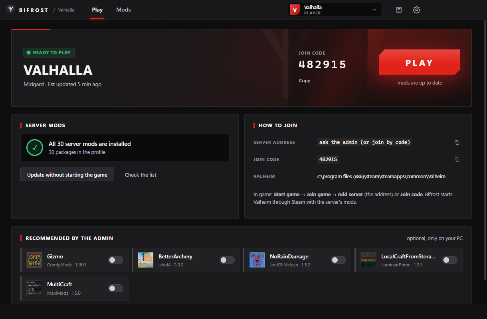
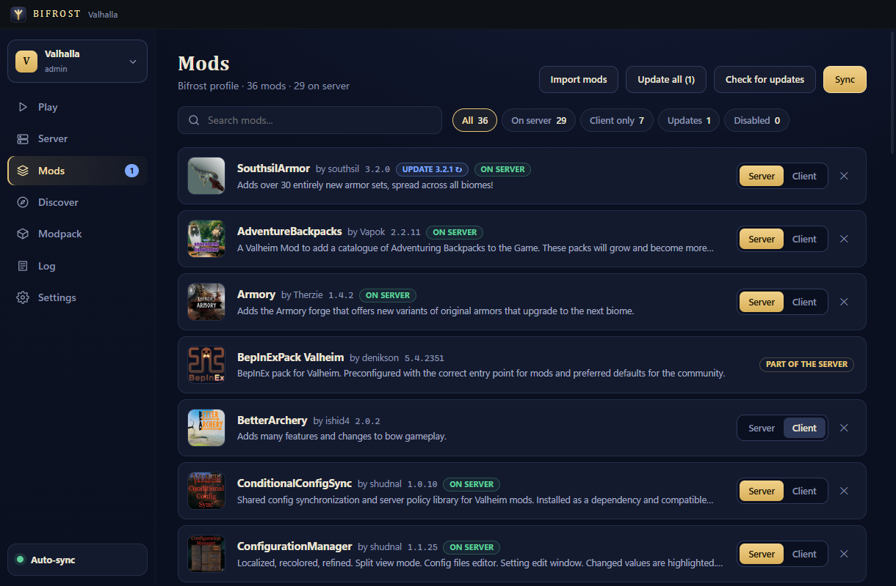
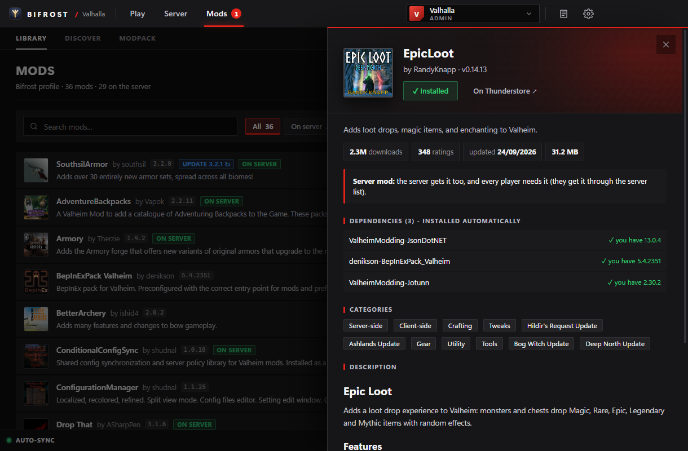

# Bifrost

A Valheim mod manager built for one thing: playing on a modded server with friends, where everyone always has exactly
the server's mods.

- **Players** open an invite link, press **PLAY**, and Bifrost installs the server's mods (exact versions, from
  Thunderstore and Nexus Mods), keeps them up to date and starts Valheim through Steam with them.
- **Server admins** manage the mods in Bifrost. Bifrost puts them on the server, keeps the configs in sync both ways,
  restarts the server only when nobody is playing, and publishes the list their friends' Bifrost reads.
- Every server has its own mod profile; switch between servers in the sidebar. Personal profiles (no server) work too.

English by default, Romanian available (Settings → Language).

| Play | Mods (admin) | Discover |
|---|---|---|
|  |  |  |
| A friend opened the invite: the server's 30 mods are installed, PLAY starts Valheim with them. | The admin marks each mod *Server* or *Client*; Bifrost keeps the server in sync and publishes the list. | Browse Thunderstore and Nexus Mods; *Install* puts the mod and its dependencies into the server's profile. |

## Install

Download from [Releases](../../releases/latest):

**Windows**

- `Bifrost-Setup-x.y.z.exe` - installer, or
- `Bifrost-x.y.z-win.zip` - portable: unzip anywhere and run `Bifrost.exe`.

**Linux** (x64)

- `Bifrost-x.y.z-linux-amd64.deb` - Debian / Ubuntu / Mint: `sudo apt install ./Bifrost-x.y.z-linux-amd64.deb`, or
- `Bifrost-x.y.z-linux-x86_64.AppImage` - any distro: `chmod +x Bifrost-*.AppImage` and run it (needs FUSE 2,
  e.g. `libfuse2` / `libfuse2t64` on Ubuntu).

Bifrost finds Steam (native, Flatpak or Snap) and both ways of running Valheim on Linux:

- the **native Linux build**: Bifrost starts `valheim.x86_64` itself through the profile's `start_game_bepinex.sh`
  (Steam must be running); nothing is put into the game folder.
- the **Windows build under Proton**: like on Windows (doorstop next to `valheim.exe`), plus the `winhttp` DLL override
  in the game's Proton prefix, so no Steam launch options are needed. Start Valheim once from Steam first, so that the
  prefix exists.

Settings, profiles and the download cache live in `~/.config/Bifrost`.

Bifrost is not code-signed. SmartScreen may say *Windows protected your PC* → *More info → Run anyway*. On PCs with
**Smart App Control** turned on, an unknown installer can be blocked; use the portable zip there (`Bifrost.exe` is the
unmodified Electron binary, which Windows knows). Bifrost updates itself by downloading only its code
(`bifrost-app-*.zip`), never a new executable.

## Players

1. Get the invite from the server admin: a link (`https://florincamarut1.github.io/bifrost/join.html#g.…`) or a code (`g.…`).
2. Open it - or in Bifrost: *I got an invite* and paste it.
3. Press **PLAY**.

Mods go into `%APPDATA%\Bifrost\profiles\<server>` (Linux: `~/.config/Bifrost/profiles/<server>`). To load that profile, Bifrost puts the BepInEx doorstop
(`winhttp.dll`, `doorstop_config.ini`, `doorstop_libs`) next to `valheim.exe`; what was there before (e.g. another mod
manager's loader) is copied to `bifrost-backup` and can be restored in Settings.

## Admins

*Create server* asks for:

| Connection | For | Restart |
|---|---|---|
| Linux over SSH, Docker | the [valheim-server](https://github.com/community-valheim-tools/valheim-server-docker) image (default paths `/config/valheimplus/...`) | yes - only while nobody plays; join code from the logs |
| Linux over SSH | any folders on a Linux host | optional command, e.g. `sudo systemctl restart valheim` |
| This PC | a dedicated server on the same machine | optional command |
| FTP / FTPS | rented servers | from the host's panel |
| None | just the list for friends | - |

SSH uses your key (no passwords). The mods can start from what the server already runs, from Thunderstore Mod Manager /
r2modman on the PC, from a Thunderstore profile code, or empty.

Then, automatically:

- **mods**: every mod is *server* (server + all players need it) or *client* (players only); new ones are guessed from
  their README/DLLs, dependencies of server mods follow them. With *All mods on the server*, client mods go on the server
  too (for players it only decides required vs. recommended). A mass removal (an emptied profile) is refused.
- **configs**: `BepInEx/config` ↔ server, 3-way (whoever changed since the last sync wins; on first contact the server
  wins for server mods, the player for client mods). Runtime data (saves, logs) is skipped.
- **editing configs**: *Mods → ⚙* opens every setting of a mod (toggles, lists, numbers, with the description and
  default BepInEx writes; or the raw file). *Save* writes it into the profile and sends it to the server at once;
  *Restart the server when empty* applies it for mods that only read their config at start.
- **mods put on the server by hand** are brought into the profile and managed from then on.
- **the list** (`server.json`) is published to a secret Gist on your GitHub account (log in from Settings → Accounts,
  paste a token with the `gist` scope, or have the GitHub CLI logged in). The public IP is only included if you turn
  it on; players join by join code otherwise.

Optional: a Thunderstore modpack package with the server's mods, for people without Bifrost.

## Nexus Mods

Settings → Accounts → your personal API key. Free accounts click *Slow download* once per file on the Nexus page and
Bifrost installs it (it registers the `nxm://` link); Premium downloads directly. zip, 7z, rar and bare DLLs work.

## Development

```
npm install
npm start           # run from source
npx electron-builder --win nsis zip --publish never      # Windows
npx electron-builder --linux AppImage deb --publish never  # Linux
```

Releases (Windows + Linux) are built by GitHub Actions when a `v*` tag is pushed (`.github/workflows/release.yml`).

Test hooks: `--data=<dir>` (separate settings/profiles), `--hidden`, `--run=<action>[:<json>|:@file]`,
`--shot=<dir> --pages=a,b` (screenshots, rendered off-screen).

`server.json`: `{ schema, app: "bifrost", server: { name, world, joinCode, address }, required: [{ full, ver }],
recommended: [{ full, ver }], nexus: [{ key, title, modId, fileId, version, required }] }`.

## License

MIT
